# TGMT5 — Telegram → MetaTrader 5 Copy Trading

[](https://github.com/iulian880/tgmt5/actions/workflows/tests.yml)
[](https://github.com/iulian880/tgmt5/actions/workflows/build.yml)


[](https://github.com/iulian880/tgmt5/releases/latest)


A **Windows desktop application** (Python 3.12+, PySide6 + qasync, SQLite/WAL, Telethon, official MetaTrader5 API) that reads trading signals from private Telegram groups you belong to, interprets them with a **deterministic parser**, validates every trade through a **persisted risk engine**, and executes it on **MetaTrader 5** — **DEMO by default**, or a real-money account in the explicitly gated **REAL ACCOUNT** mode (built and tested against an IC Markets SC account model).

It **always starts in monitor-only mode**, refuses real-money accounts at the backend level unless you explicitly opt in and confirm the account by typing its number, commits every order leg to SQLite *before* calling `order_send`, and never guesses on an ambiguous signal.

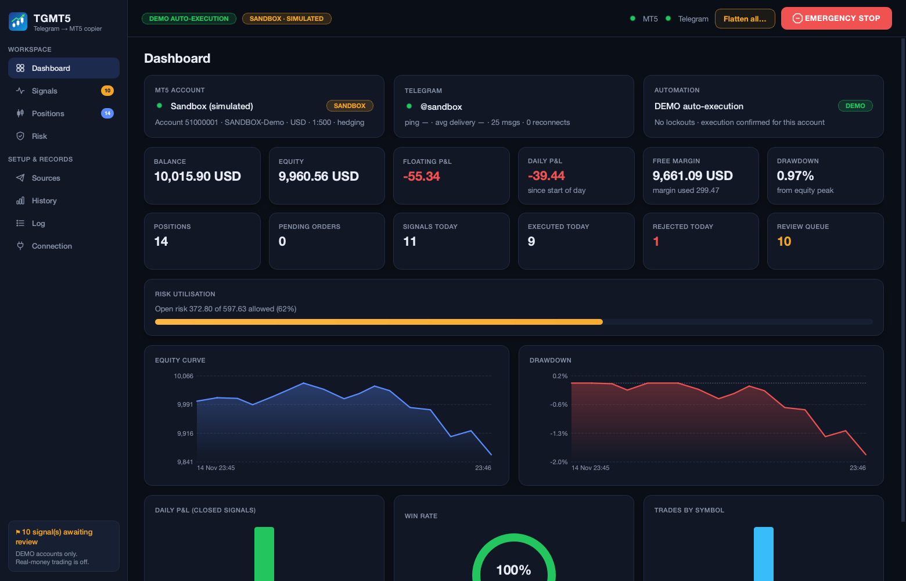

> **Risk disclaimer.** This is an educational / portfolio project. Real-money trading is **off by default**; if you turn it on, every loss is yours. Trading leveraged products such as forex and CFDs carries a high risk of losing money. Nothing in this repository is financial advice, and simulated or demo results do not predict live results. Use at your own risk; see [LICENSE](LICENSE).

---

## Why TGMT5 — engineered for safety over convenience

Most Telegram-to-MT5 copiers either wrap an LLM around raw chat text, assume hard-coded pip values, or fire-and-forget orders without idempotency. `TGMT5` is designed like a small execution system where **every failure mode defaults to doing nothing**:

| Dimension | Typical Telegram copy scripts | LLM / webhook copiers | `TGMT5` |
|---|---|---|---|
| **Signal interpretation** | Loose regexes that misread chat as commands | Non-deterministic; can hallucinate SL/TP or price | **Pure deterministic parser** — strict geometry, comma-decimal & conditional guards; anything uncertain goes to **Manual Review** |
| **Position sizing** | Hard-coded `$10/pip` or fixed lots | Often ignores broker contract specs or multi-TP splits | **Broker-driven `order_calc_profit()`** with tick-value fallback, floor-to-step rounding, 6 sizing modes, and budget split across all TP legs |
| **Duplicate & timeout safety** | Re-sends on timeout or restart, duplicating trades | Stateless webhooks | **SQLite commit before `order_send`** with unique `TG<sig>L<leg>` tags; `UNCERTAIN` legs reconcile positions, orders & 7-day deals before a single bounded retry |
| **Account protection** | Trades whatever terminal is logged in | API keys on third-party servers | **Double `AccountGuard`** (connect + every order) + **MONITOR-on-start** + 3-step typed confirmation for `REAL ACCOUNT` + persistent **EMERGENCY STOP** |
| **Risk lockouts & review** | Optional UI toggles reset on restart | None | **16-rule Risk Engine** (daily loss, drawdown, streak breaker, exposure, margin, sessions) persisted in SQLite + red **Pre-trade review** ticks |
| **Secrets & auditability** | Plaintext `.env` / JSON files | Cloud-hosted credentials | **OS Keyring only** (Windows Credential Manager) + automatic secret redaction in JSON logs, console tracebacks & SQLite audit trail |
| **Offline exploration** | Requires live credentials | Requires subscription | Built-in **`--sandbox`** mode (simulated broker + Telegram feed, any OS) and **Paper trading** on live MT5 quotes |

---

## Highlights

- **Deterministic signal parser.** Handles market, entry-zone, explicit `BUY/SELL LIMIT` & `STOP`, multi-TP (`TP1/TP2/TP3`, `TP open`), symbol aliases (`GOLD → XAUUSD`, `NAS → NAS100`, plus per-source custom aliases), and follow-up commands (*Move SL to BE*, *SL to 2655*, *New TP 2700*, *Close 50%*, *Close all*, *Cancel pending*, *TP1 hit*). Negations (*"don't close"*), everyday chat (*"close to TP1"*), European comma decimals (*"1,0850"*), and conditional instructions (*"close 50% if price hits 2670"*) are never executed blindly.
- **Lot sizing from the broker's own specs.** Six sizing methods (*Fixed lot per TP*, *Fixed total lot*, *Fixed money at risk*, *% of equity*, *% of balance*, *Lot per balance step*). Loss at SL comes directly from `order_calc_profit()` so currency conversion, contract size and tick value always match the terminal. Volumes round **down** to the broker step; the signal's risk budget is split across all TP legs so 3 TPs never triple your risk.
- **16-rule Risk Engine & pre-trade review.** Enforces per-signal risk, total open risk, correlated group exposure, per-symbol and per-order lot caps, daily-loss lockout, max-drawdown lockout, consecutive-loss circuit breaker, max concurrent trades, hourly frequency, margin usage, free margin, unit-free spread & entry-deviation filters, minimum R:R, UTC sessions, and symbol white/blacklists. Critical risk fields stay red until individually ticked (`✓`) — auto-execution is blocked until reviewed.
- **Idempotent execution without duplicates.** Every order leg is committed to SQLite with a unique client tag (`TG<signal>L<leg>`) *before* `order_send`. On timeout, disconnect, or missing result, the leg becomes `UNCERTAIN`, waits a grace period, and reconciles against live positions, pending orders, and 7 days of deal history. A single retry is allowed only when proven absent and still within slippage; if the broker cannot be queried, the leg stays `UNCERTAIN` and is never retried.
- **Double `AccountGuard` & 3-step `REAL ACCOUNT` opt-in.** Verifies account type, login and server on connect and again on *every* trade request. Real-money trading is off by default and requires: (1) enabling *Allow real-money accounts*, (2) switching to **REAL ACCOUNT** mode, and (3) typing the exact account number to confirm. Outside REAL ACCOUNT mode, only risk-reducing actions (closing or modifying SL/TP) are allowed; any unexpected real-account order engages a persistent emergency stop.
- **Start-up recovery & trade management.** Reconciles uncertain/submitting orders, positions closed offline, expired waiting signals, and unmanaged orphan positions carrying our magic number. Supports automatic TP1 → Breakeven, trailing stops, hedging multi-leg splits, and netting `SINGLE_MANAGED` partial closes. Never replays historical Telegram messages (`catch_up=False`).
- **Paper trading & full analytics.** Simulates fills on live MT5 quotes with configurable extra spread, slippage, and commission per lot. Paper results, equity curves, and CSV exports are strictly isolated from broker trades.

---

## Interface showcase

All screenshots below are captured directly from the built-in **`--sandbox`** mode (simulated broker & Telegram feed, so all prices and P&L figures are synthetic).

### Core trading workspace (Dark theme)

| Live Signal Monitor (timeline & review queue) | Open Positions & Pending Orders |
|---|---|
| 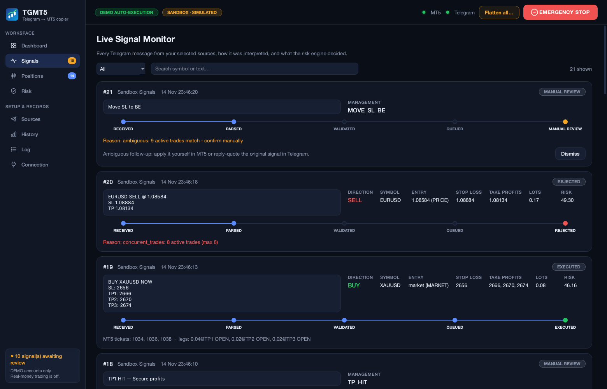 | 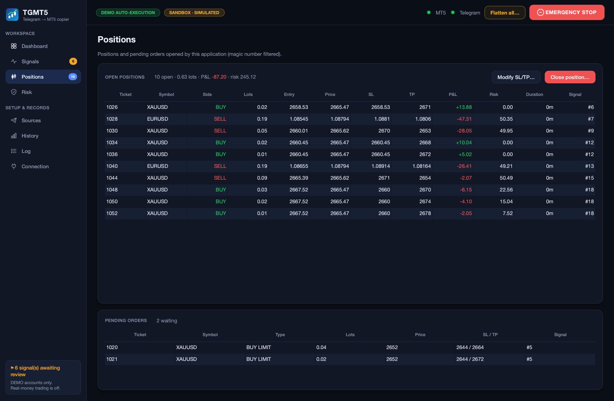 |
| **Risk Console & Live Account Sizing Preview** | **Trade History & Performance Analytics** |
| 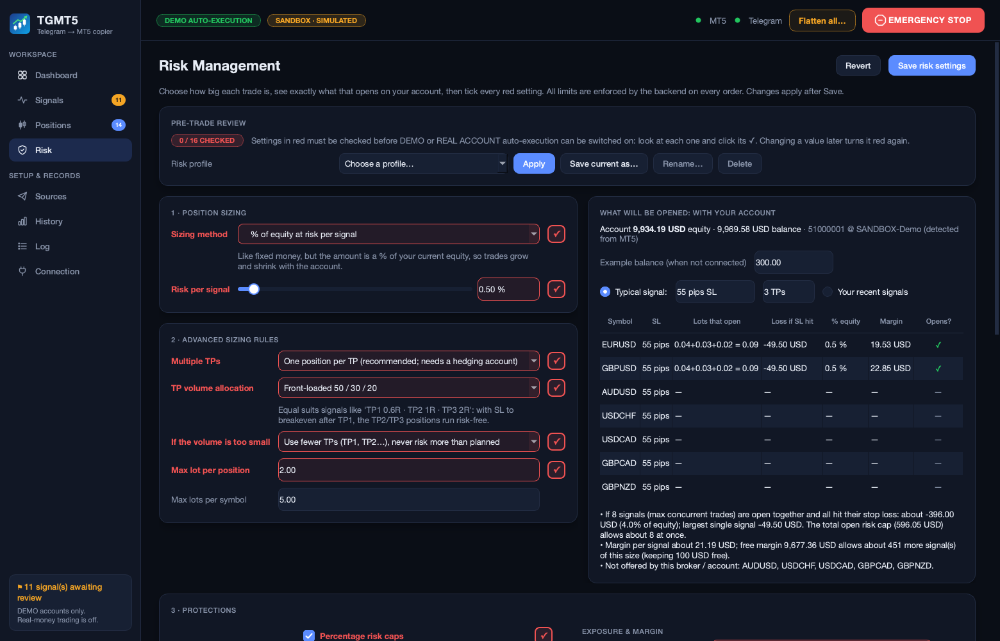 | 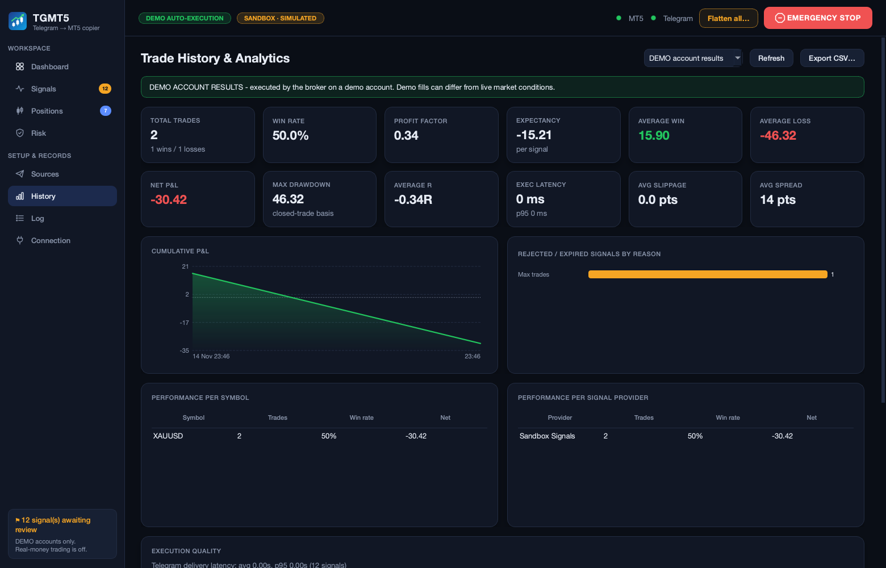 |

### Setup, diagnostics & audit trail

| Telegram Sources & Per-Source Templates | Connection, Account Guard & Execution Modes |
|---|---|
| 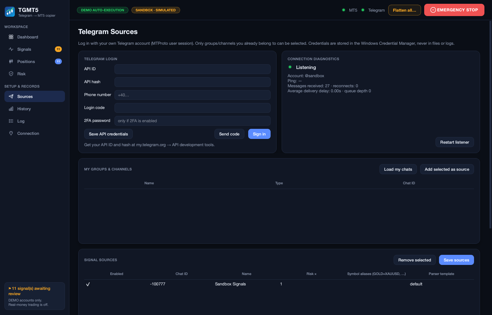 | 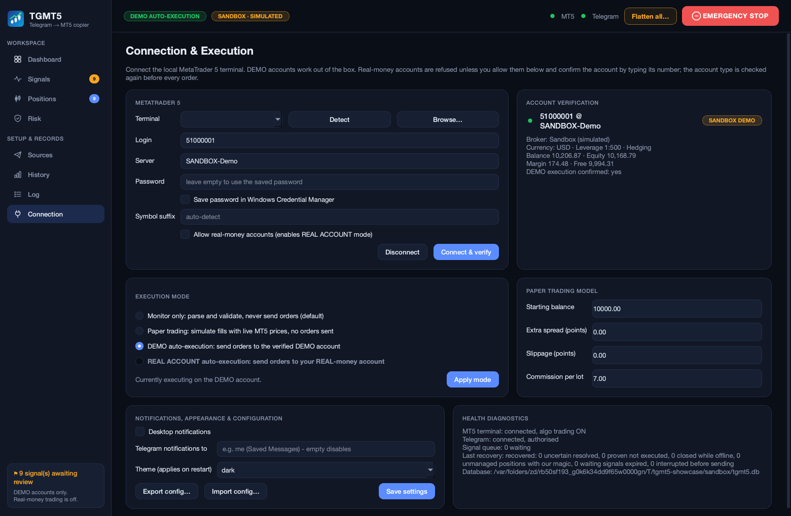 |

| Searchable Activity & Redacted Audit Log | Light Theme Support (Dashboard) |
|---|---|
| 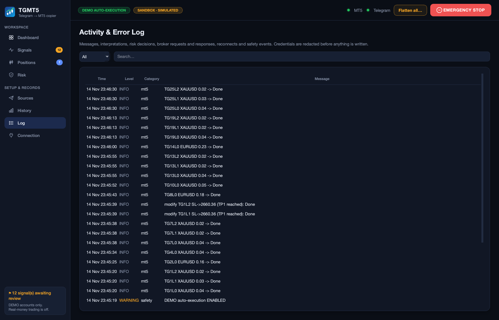 | 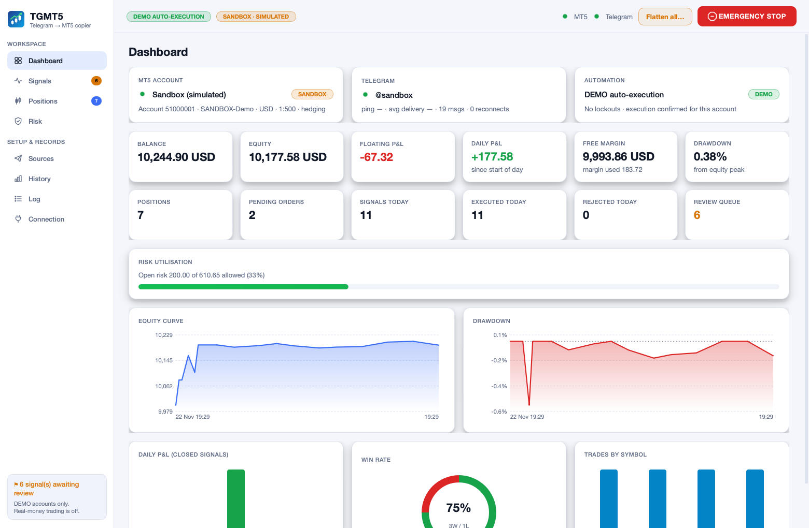 |

<details>
<summary>More Light Theme screens (Signals, Positions, Risk, History)</summary>

| Signals (Light) | Positions (Light) |
|---|---|
| 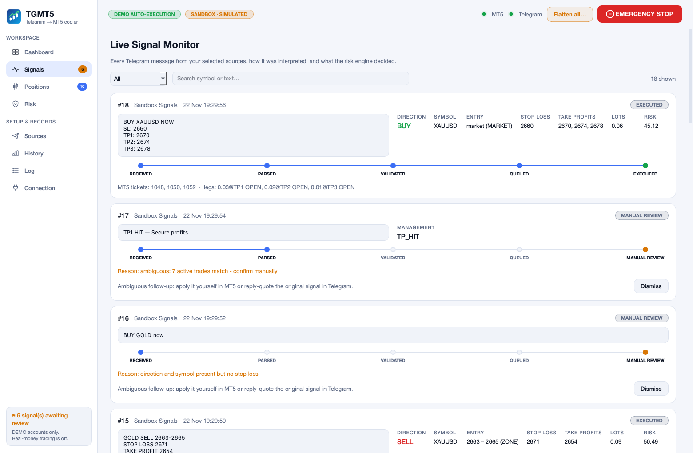 | 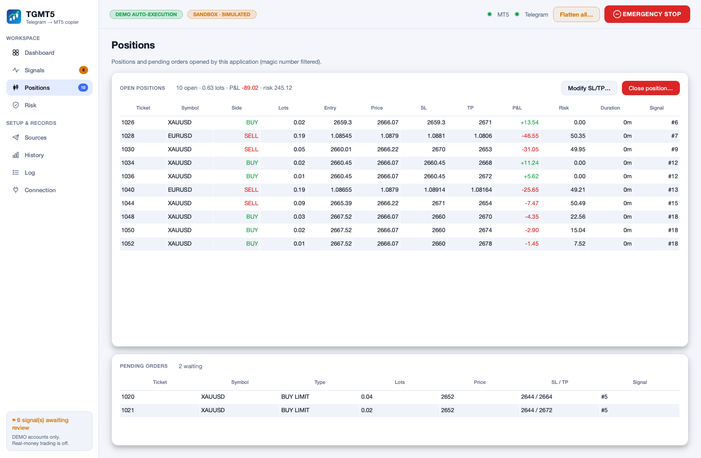 |
| **Risk Console (Light)** | **History & Analytics (Light)** |
| 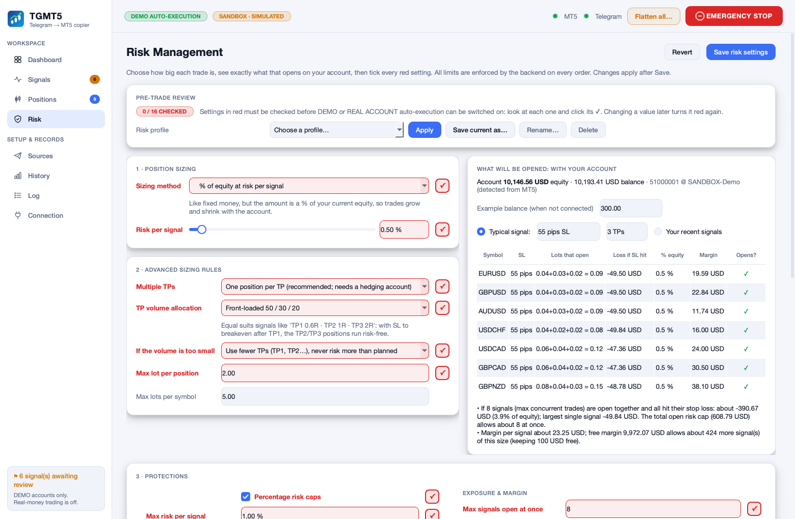 | 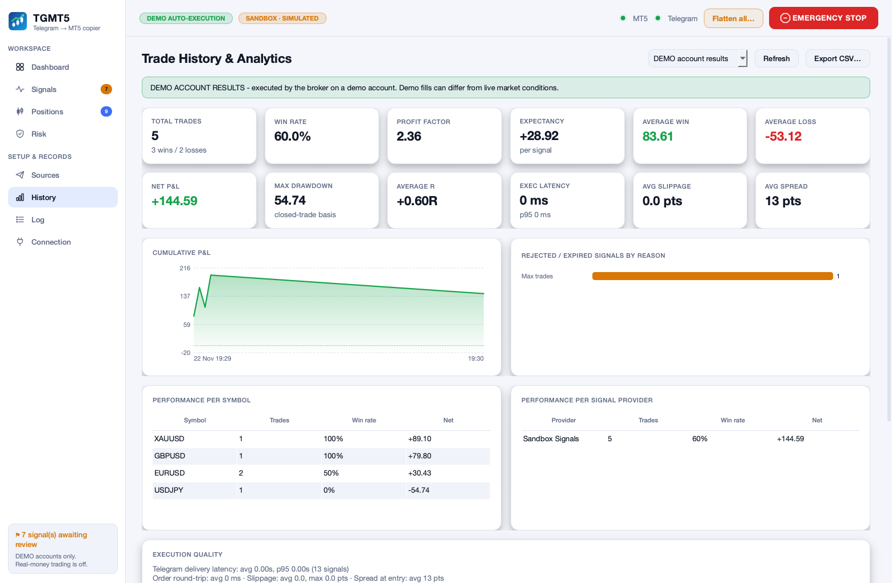 |

</details>

---

## Architecture

```text
 Telegram (Telethon, MTProto user session — catch_up=False)
        │  NEW / EDIT / DELETE events
        ▼
 bounded asyncio.Queue (max 1000) ──► single dedicated `mt5` worker thread (serial)
                                           │
                                           ├─ SignalParser     (pure, deterministic, zero I/O)
                                           ├─ ExecutionEngine  (state machine, idempotency, reconcile)
                                           │     ├─ RiskEngine (16 checks, persisted lockouts)
                                           │     ├─ sizing     (order_calc_profit, step/min/max)
                                           │     └─ management (BE, partials, trailing, follow-ups)
                                           ├─ AccountGuard ──► MT5Gateway (MetaTrader5 | Paper | Sim)
                                           └─ SQLite (WAL, synchronous=FULL, Alembic migrations)
        ▲
 PySide6 UI (qasync) ── calls AppService only; has zero direct access to order sending
```

All `MetaTrader5` calls and pipeline state transitions execute serially on a single worker thread (the official MT5 package is not thread-safe, and serialization eliminates risk-check races between simultaneous signals). See [docs/ARCHITECTURE.md](docs/ARCHITECTURE.md) for the full state machine, database schema, and design decisions.

---

## Download (Windows)

Get both signed executables from the [latest GitHub Release](https://github.com/iulian880/tgmt5/releases/latest):

| File | Use it when |
|---|---|
| `TGMT5-Setup-<version>.exe` | Standard Windows installer. Wizard lets you pick current user (no admin) or all users, install folder, Start-menu shortcuts, desktop/Sandbox shortcuts, and start with Windows. |
| `TGMT5-Portable-<version>.exe` | Single self-contained executable — no installation, no admin rights. Stores its data in `TGMT5-data\` beside the `.exe`. |

MetaTrader 5 is required for live/demo trading; `--sandbox` runs standalone without MT5 or Telegram. Releases are signed with a self-signed test certificate, so Windows SmartScreen will prompt: click **More info → Run anyway** (details in [docs/INSTALL_WINDOWS.md](docs/INSTALL_WINDOWS.md)). **Updating:** run the new Setup over your existing install — settings, history, and Credential Manager secrets are preserved, and the database is backed up automatically first.

---

## Quick start (from source)

```powershell
# Windows 10/11, Python 3.12+, MetaTrader 5 terminal installed
git clone https://github.com/iulian880/tgmt5
cd tgmt5
py -3 -m venv .venv
.\.venv\Scripts\Activate.ps1
pip install -e ".[dev]"
python -m tgmt5             # real mode (always starts in MONITOR ONLY)
python -m tgmt5 --sandbox   # explore everything with a simulated broker + Telegram feed (any OS)
```

---

## Verification & automated tests

```bash
QT_QPA_PLATFORM=offscreen pytest -q   # 299 passed, 0 warnings (no credentials or broker needed)
pytest -m demo_e2e -s                 # optional real DEMO round trip (Windows + explicit opt-in)
```

The test suite spans **16 test modules (299 tests)** running in CI across Ubuntu and Windows on Python 3.12–3.14, covering:

- **Parser & safety regressions** (`test_parser.py`, `test_regressions_v040.py`, `test_regressions_v050.py`): all signal formats, aliases, false positives, chat-not-commands, comma decimals, conditional commands, zero-price guards, edits, and deletions.
- **Position sizing & risk profiles** (`test_sizing.py`, `test_sizing_modes.py`, `test_risk_profiles.py`): FX/XAU/JPY sizing, floor-to-step rounding, multi-TP budget splits, small-account policies, pre-trade review stamping, and live/offline previews.
- **Execution, management & recovery** (`test_engine.py`, `test_management.py`, `test_real_account.py`): idempotency, timeouts (both executed and absent), unreachable broker reconciliation, partial fills, BE/trailing/managed partials, netting protection, emergency stop, flatten-all, and 3-step `REAL ACCOUNT` blocking.
- **Service, persistence, security & UI** (`test_service.py`, `test_telegram.py`, `test_config_compat.py`, `test_startup_shutdown.py`, `test_main.py`, `test_ui_smoke.py`): async worker-thread serialization, SQLite + Alembic migrations, secret redaction in logs/tracebacks/DB payloads, and offscreen rendering of all 8 UI pages.

*Honest verification note:* Real `MetaTrader5` terminal IPC and live Telethon network sessions are Windows/live-only and are not exercised in headless macOS/Ubuntu test runs; Windows packaging and `--sandbox` startup are verified on every push by GitHub Actions (`windows-latest`). See [docs/TEST_REPORT.md](docs/TEST_REPORT.md) for the full breakdown and known limitations.

---

## Documentation

- [Architecture & state machine](docs/ARCHITECTURE.md)
- [Windows installation, installer, portable build & code signing](docs/INSTALL_WINDOWS.md)
- [Telegram API setup](docs/TELEGRAM_SETUP.md)
- [IC Markets SC DEMO & MT5 setup](docs/MT5_DEMO_SETUP.md)
- [User guide (modes, sizing, profiles, small accounts)](docs/USER_GUIDE.md)
- [Troubleshooting](docs/TROUBLESHOOTING.md)
- [Test report & known limitations](docs/TEST_REPORT.md)
- [Release notes (v0.5.1)](docs/release-notes/v0.5.1.md) · [v0.5.0](docs/release-notes/v0.5.0.md) · [v0.4.0](docs/release-notes/v0.4.0.md)

---

## Tech stack

Python 3.12+ · MetaTrader5 · Telethon · PySide6 + qasync · SQLAlchemy 2 + Alembic · SQLite (WAL) · Pydantic 2 · keyring · pytest · PyInstaller · Inno Setup · GitHub Actions

## License

MIT © 2026 Petcu Iulian
